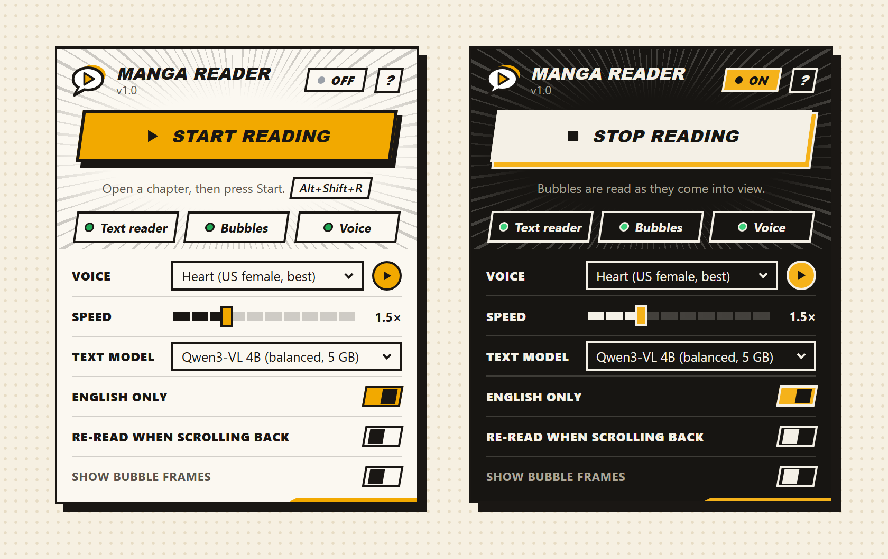
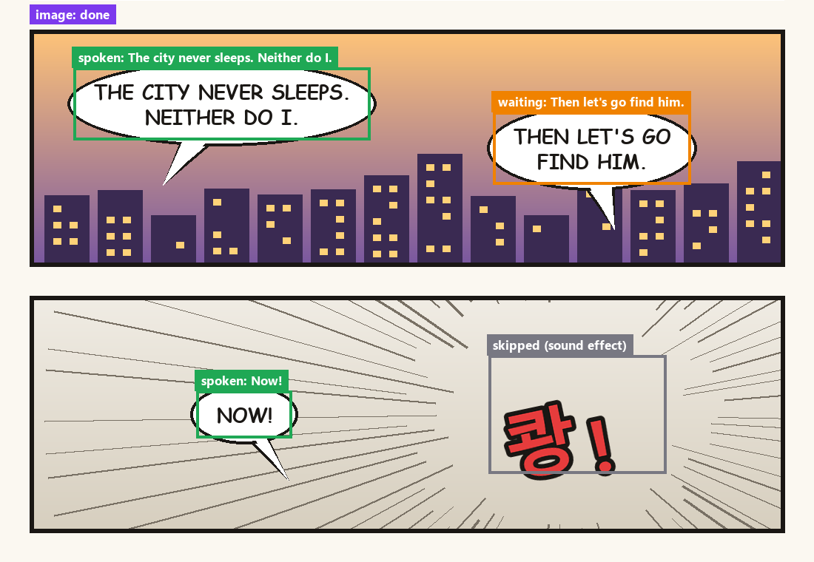
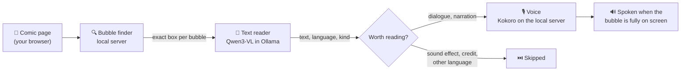
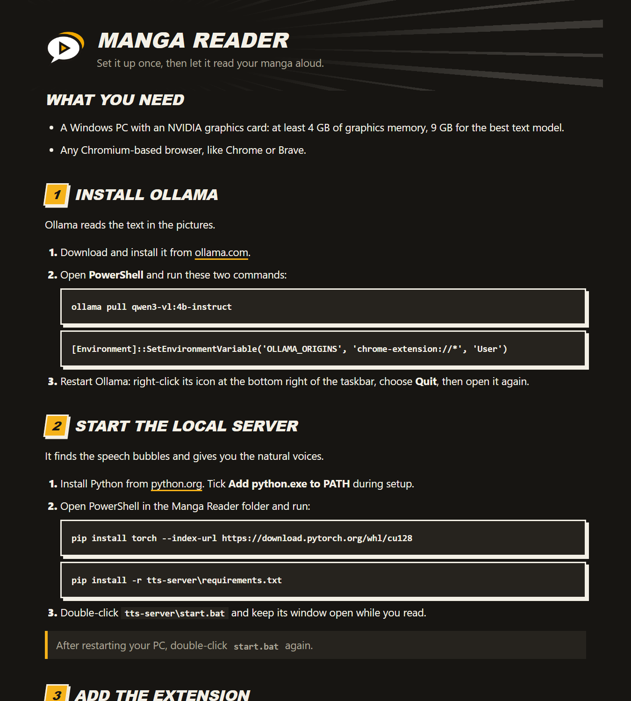

<div align="center">


# Manga Reader TTS

**Your manga, manhwa and manhua, read aloud as you scroll.**

A browser extension that finds the speech bubbles in comic pages, reads their text with a local AI model
and speaks each bubble the moment it's fully on screen. Everything runs on your own PC.




</div>

## Features

- 🗨️ **Reads bubbles as you scroll.** Each bubble is spoken once it's fully visible, in reading order.
- 🎯 **Finds bubbles precisely.** A comic bubble detector frames every bubble and caption; the AI then reads each one on its own.
- 🧩 **Handles webtoon strips.** Bubbles cut in half between two images are joined and read whole.
- 🔇 **Skips the noise.** Sound effects, watermarks, scanlation credits and non-English text are left out.
- 🎙️ **Natural voices.** 15 English AI voices (US and UK) ready to use and 28 available, or your browser's own voices. Speed up to 4× without the chipmunk effect.
- 🔁 **Keeps going.** Reading continues into the next chapter on the same site.
- 🔒 **Private.** No accounts, no cloud: the models run on your graphics card.

<div align="center">

<br /><sub>With <b>Show bubble frames</b> on, you see what the reader found: spoken, waiting and skipped bubbles.</sub>
</div>

## How it works



1. The extension finds the comic images on the page, starting with the one closest to where you are.
2. The **bubble finder** draws an exact box around every speech bubble and caption.
3. The **text reader** reads each box on its own and says what kind of text it is.
4. Dialogue and narration go to the **voice**; sound effects, credits and other languages are skipped.
5. Each bubble is spoken when it's fully on screen. The next ones are prepared while one is playing, so there's no wait between them.

## What you need

- A Windows PC with an **NVIDIA graphics card**: at least **4 GB** of graphics memory, **9 GB** for the best text model.
- Any **Chromium-based browser**, like Chrome or Brave.

## Install

The extension has a built-in setup guide: click **?** in the popup. In short:

**1. Ollama** reads the text. Install it from [ollama.com](https://ollama.com), then in PowerShell:

```powershell
ollama pull qwen3-vl:4b-instruct
[Environment]::SetEnvironmentVariable('OLLAMA_ORIGINS', 'chrome-extension://*', 'User')
```

Restart Ollama afterwards.

**2. The local server** finds the bubbles and gives you the AI voices. Install [Python](https://www.python.org/downloads/), then in the project folder:

```powershell
pip install torch --index-url https://download.pytorch.org/whl/cu128
pip install -r tts-server\requirements.txt
```

Double-click `tts-server\start.bat` and keep it open while you read.

**3. The extension.** Open your browser's extensions page, turn on **Developer mode**, click **Load unpacked** and choose the `extension` folder.

<div align="center">

</div>

## Use

Open a chapter, click the extension icon and press **Start reading**, or press <kbd>Alt</kbd>+<kbd>Shift</kbd>+<kbd>R</kbd>.

| Setting | What it does |
| --- | --- |
| **Voice** | An AI voice from the local server, or one of your browser's voices. ▶ plays a sample. |
| **Speed** | 0.5× to 4×. |
| **Text model** | Which Ollama model reads the text. Smaller is faster, bigger is more accurate. |
| **English only** | Skip text in other languages. |
| **Re-read when scrolling back** | Read a bubble again when you scroll back to it. |
| **Show bubble frames** | Frame every found bubble on the page with its status. |

The three status marks in the popup (**Text reader**, **Bubbles**, **Voice**) turn green when everything works. Hover one to see what's wrong.

## Change the models

- **Text model:** `ollama pull <model>` any Ollama model that can read images, and it shows up in the popup.
- **Voices:** edit `tts-server\settings.json` and restart `start.bat`. All available voice names are listed in the setup guide.

## Project layout

```
extension/          the browser extension
  popup.*           the toolbar popup
  guide.*           the setup guide page
  content.js        runs on the comic page: finds images, tracks bubbles, queues speech
  background.js     OCR and speech coordination
  lib/              OCR, voices, settings
tts-server/         local server: bubble finder + Kokoro voices (localhost:5005)
docs/               README pictures
```

<details>
<summary><b>Under the hood</b></summary>

- **Bubble finder:** [comic-text-and-bubble-detector](https://huggingface.co/ogkalu/comic-text-and-bubble-detector), an RT-DETR-v2 model trained on manga, webtoon, manhua and western comics. Each image is cut into overlapping squares; text inside a bubble takes the bubble's box, captions keep their own.
- **Cut-outs:** each box is read with a small margin. Other text reaching into it (a watermark on the edge, signs behind it) is painted over first, and the box's own text is never covered.
- **Split bubbles:** each image is read together with the edges of the images above and below it, so whichever is read second sees a bubble cut by the border whole.
- **Without the local server**, Qwen3-VL finds and reads the bubbles itself on overlapping tiles. It works, but slower and with rougher boxes.
- **Clean-up:** looping model output is cut to one copy, lines of one bubble are joined, duplicates from neighbouring images are merged, and a line is never spoken twice within 30 seconds.
- **Never stuck:** OCR and speech requests time out, failed images are retried, and slow images are waited for.
- **Speed on an RTX 5080:** the bubble finder takes well under a second per page, reading a bubble about 0.3–0.6 s with the 4B model, and a voice clip about 0.1 s.

</details>

## Credits

- [Ollama](https://ollama.com) with [Qwen3-VL](https://huggingface.co/Qwen) for reading text (Apache-2.0)
- [Kokoro-82M](https://huggingface.co/hexgrad/Kokoro-82M) for the voices (Apache-2.0)
- [comic-text-and-bubble-detector](https://huggingface.co/ogkalu/comic-text-and-bubble-detector) for finding bubbles (Apache-2.0)
